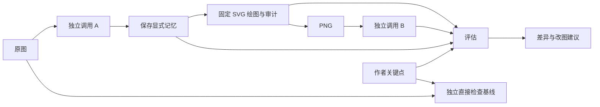

# Research Figure Evaluator：总纲与指挥台

**实际进度（2026-10-22）：应用、四张真实论文素材和教学流水线已实现；11 个测试文件 75 项单测、lint/类型、生产构建通过，16 项界面检查与 24 项历史/深链接检查通过。真实本地视觉模型闭环已完成：固定协议 4 图 × 3 次完成 8/12，失败显式记录。T08 修复补齐历史回放、默认配置一致性、逐请求审计、检测覆盖与科学负例；T09 修正语义覆盖科学规则、双侧面板歧义、阈值容差和 partial usage；T10 修正小量级阈值误判、B-only 面板漏报，并给证据生成脚本加独立命名和默认拒绝覆盖。继续工作先读 [HANDOFF](HANDOFF.md) 和 [实际验证](DELIVERY_VALIDATION.md)，不要将下文历史规划当作未实现清单。参赛文稿草案见 `submission/`，尚未发布。**

版本：planning-0.1，2026-10-21。负责人：玉米。**更新：玉米已授权实施并扩大跨领域/图类型范围；当前冻结设计和真实进度见 [IMPLEMENTATION](IMPLEMENTATION.md)。以下保留原规划，其中机制图范围已由新合同取代。**

## 1. 唯一目标

尽快交付一个可运行、可演示、可复核的黑客松成品：作者上传机制图并写下 3–5 个关键信息，看到 AI 对原图的理解、由理解重建的图，以及关键信息在各阶段的保留或偏差；修改图后可按相同条件比较。

“最终版”在这里指**比赛可交付版本**，不是生产级平台。先把这条主路径做完，再按实测价值优化。

一句英文介绍草案：**See what survives when an AI reader reconstructs your scientific figure.**

产品承诺是 AI 模拟读者反馈。首版不声称测量人类记忆、验证科学真实性、评价全部科研图质量，也不声称已经优于直接看图检查。

## 2. 我对原方案的取舍

| 决策 | 首版处理 | 理由 |
|---|---|---|
| 保留理解—记忆—重建—再理解 | 必做 | 重建图是用户观察误解的主要产物 |
| “记忆” | 显式中间表示，不人为压缩 | 没有经过验证的容量/时间设置，不能把随机截断包装成人类记忆实验 |
| 图注 | 首版固定仅看图，图内图例保留 | 否则测到的是图+图注，A 读文字、B 只看图也会造成条件不对称 |
| 图范围 | 单面板机制图/流程图，普通标签、方向、促进/抑制/关联/流程、虚实线、单层分组、条件、证据状态 | 保证语义字段都能画出来；多面板晚于主路径 |
| 输入格式 | PNG/JPEG；默认不接用户 SVG/PDF | 避免同时承担论文提图、子图拆分和任意 SVG 处理 |
| 重建 | 受控 SVG→PNG；B 只收 PNG | 可测试绘图语义，不引入自由生图的不稳定性 |
| 评价 | 三段比较+绘图审计，逐条依据 | 不把重画/再读损失一律算成原图问题 |
| 原图定位 | 有可靠 bbox 才高亮，否则显示关联文字/条目 | 不虚构精确定位；定位失败不妨碍报告 |
| 首版模型 | 一个可用视觉模型的独立请求 | 降低接入成本，但明确不保证错误独立 |
| 数据规模 | 先 1 对跑通，候选版最低 3 对，目标 6 对 | 数据扩充必须晚于真实闭环；不能 12 张都画完才发现链路不工作 |
| 在线部署 | 本地可运行先验收，部署另行授权 | 本地文件存储需要持久磁盘，不能假定普通无状态托管可直接工作 |

## 3. 成品的用户路径

1. 选择一个内置示例，或上传一张图；清楚提示图片将发到所配置的模型服务。
2. 输入 3–5 条原子关键点。系统展示结构化后的检查含义；无法映射的条目请作者补清，不偷改作者意图。
3. 开始检查，看到真实阶段状态：读取→重建→再读→比较；失败明确指出阶段，可重试并保留旧记录。
4. 结果页并排展示原图和重建图，下方按关键点显示 A、B 的理解、差异、证据及建议。A 的“笔记”是结构化事实摘要，不索取或展示隐藏思维链。
5. 点击差异查看关联条目及可用的原图区域，区分确定发现和修改假设。
6. 上传修改版，复用原关键点与配置，逐条比较；若模型、提示词或关键点不同，提示不可直接作受控比较。
7. 导出非敏感 JSON/Markdown 报告；演示可打开有明确标签的真实历史回放。

## 4. 主链路与信息边界

三个主比较是 K→A、A→B、K→B。额外审计 M→rendered（哪些语义实际画出）。A→B 只能表示这段流程观察到的变化；即使绘图审计通过，也不自动证明是 B 或原图的唯一原因。

基线要分清：**A-only** 是无额外调用的盲读基线（K→A）；**direct-check** 是另一条“原图+关键点→直接检查”的实用基线，故意知道检查目标，结果不能回流 A/B。它回答用户是否值得多付一次重建成本，不承担公平测量盲读能力的任务。

## 5. 技术结构与控制成本

- Next.js + TypeScript，页面和 Node 服务端放同一项目；Zod 定义唯一类型来源。
- 模型 SDK 只接一种当前有权限的服务，先核对官方接口与真实可用性。密钥由玉米通过获准渠道配置；本轮不选定未经核验的型号和价格。
- 单一自动布局库配固定 SVG 模板，PNG 使用项目局部的服务端转换组件；T00 做 Windows/Node 兼容小验证，再冻结依赖。
- 不引入数据库、账户系统、向量库、训练、队列平台或独立 Python 服务。当前 Node v22.23.1、npm 10.9.8、Git 2.55.0 可执行；`python.exe` 当前指向无法启动的 WindowsApps，首版不依赖 Python。
- 运行写本地 `runs/`，完成结果不可变。首版一次仅跑一个活动任务，进程重启后将未完成任务标为 interrupted，不伪装成已恢复。
- 单次真实主链路基本为 A、B 两次视觉调用；意图归一化/语义复核与 direct-check 另记。先测 1 对的延迟、token 与账单单位，再决定批量规模；不凭空报成本。
- 当前本地目录是无提交的 `master`，没有 remote；GitHub 是空公开仓库，默认 `main`。T00 要在实现授权后统一本地关联，避免模型以为两边已同步。**本轮不改 Git 配置、不 commit、不 push。**

## 6. 阶段门槛与最短路径

| 门槛 | 必须拿到的证据 | 失败时怎样处理 |
|---|---|---|
| G0 规范与合同 | 玉米确认范围；强模型 T00/T04 冻结架构、评价/标注规则、共享 schema 与 fixture；模块负责人理解输入边界 | 不允许各模块自行改类型后硬拼 |
| G1 绘图与调用可用 | 手写记忆正确画为 SVG/PNG；A/B 独立请求；无关键点泄漏 | 先修符号、PNG 和权限；不做装饰 |
| G2 一对真实闭环 | 同一基础图两版本完成真实 A→R→B→评估，产物可追溯 | 若 API 不可用只交付明确 mock，不标为比赛成品 |
| G3 最低初步候选版 | 3 对图（2 dev+1 holdout）、真实记录、A-only/direct-check、一次重复运行、改版对比和导出；1 个保留基础图仅作初查 | 砍样例扩张、精确高亮、复杂布局；保留核心隔离与审计 |
| G4 提交版 | 完整验收、清楚的回放、英文说明/视频、最终入口确认 | 冻结功能，修阻断缺陷；公开动作等玉米许可 |

候选版最低 3 对是缩小后的可交付门槛，仍不足以证明有效性。目标 6 基础图×2 版本，其中 4 dev、2 holdout；基础图及其所有版本同 split。首版不要求多面板来凑“复杂”。

## 7. 里程碑建议

官方截止见 [比赛核验](COMPETITION.md)。以下全是北京时间的内部目标，按确认总纲后的实际开工时间调整；错过目标就缩范围，不侵占提交缓冲。

| 目标时点 | 工作结果 |
|---|---|
| 开工后 45–60 分钟 | 强模型 T00/T04 完成合同、评价规则和首批 fixture；明确允许开工的体力型子任务 |
| 开工后 3 小时 | renderer 正控和真实 A/B 单步可用；页面能消费相同 fixture |
| 开工后 6 小时 | 第一版完整主路径，至少 1 对真实运行可看 |
| 10 月 22 日 12:00 前 | 最低候选版，3 对与受控修改前后对比 |
| 10 月 22 日 20:00 | 功能冻结；有余量扩到 6 对和第二模型，不再加新主功能 |
| 10 月 23 日 02:00 | 验证材料、2 分钟核心视频、≤4 分钟完整版和一页英文稿定稿 |
| 10 月 23 日 06:00 | 玉米完成公开/提交许可和正式提交，预留 2 小时补救 |
| 10 月 23 日 08:00 | 官方统一截止 |

## 8. 并行指挥规则

任务卡见 [TASKS](TASKS.md)。**先由强模型并行完成 T00 架构与 T04 评价规则，再由体力型模型执行 T01/T02/T03/T05；T06 由强模型集成审查；T07 做批量验证取证。** 这些是角色，不要求同时有 8 个模型。只有 3 个执行位时，先给两个强模型与一个受约束的准备任务；G0 后改为模型接入、绘图、样例三个执行流，页面按 fixture 随后接入。

总指挥负责范围、接口与优先级，不接手所有模块重写。每个执行模型只修改卡内路径；共享 schema、根配置、锁文件和 API 路由交由 T00/T06。

任务交付必须附：改了什么、实际验证命令、结果、未解决项、接口是否变化。没有真实调用的“端到端完成”不接收。

### 脑力与体力的划分

这里按**判断错误的传播范围**划分，不按写代码多少划分。架构写错会让多个模块返工；体力任务做错，应能由合同和测试局部发现并重做。

| 类别 | 由谁执行 | 任务 | 能决定什么 |
|---|---|---|---|
| 脑力 | 玉米选择的更强模型 | T00 架构/schema；T04 评价口径/实体对齐/标注规则；T06 系统集成、关键审查 | 提出并冻结合同、语义、关键权衡；范围大变仍交玉米确认 |
| 体力 | 普通模型或适合持续执行的模型 | T01 已定边界的 API 实现；T02 按语义表绘图；T03 页面；T05 按批准标注制图；T07 批次运行和材料 | 在固定接口与验收标准内实现、修复、生成和验证 |
| 必须升级的混合点 | 体力模型收集证据，脑力模型裁决 | 提示词改写、绘图无法表达某语义、样例科学含义/标准答案、同义实体是否相同、分数和归因、失败后改评测条件 | 普通执行模型不能自行“修正确保跑通” |

长跑适合明确清单：按配方生成多个图版本；逐图检查标注一致性；执行批准的真实运行矩阵；为每份报告补证据与截图；处理界面全部状态。长跑不适合无限调提示词、不断换模型刷结果、边跑边改标准答案。

强模型资源优先给**定义问题和最终审查**，普通模型资源用于**在定义内扩大完成度与证据量**。模块首件先验收，再让其扩大批次；每批输出可接手的检查点。详见任务卡中的长跑协议。

## 9. 什么时候才继续优化

完成 G3 后按证据选一项：误报多则改实体对齐/不确定状态；渲染丢信息则改符号和标签；主链路不稳定则先改失败处理；用户不理解报告则改结果呈现。只有这些稳定后，才加第二模型、图注对照、多面板和更多数据。

如果往返流程只增加错误、没有比 direct-check 多给可解释反馈，保留重建作为可选可视化并诚实报告价值边界，不用多代理复杂度掩盖无收益。

## 10. 当前指挥台

| 项目 | 状态 |
|---|---|
| 原方案阅读/官方公开资料核验 | 已完成；旧聊天未能读取 |
| 项目规则/总纲/合同/任务卡/验证方案 | 本轮建立 |
| 产品实现、样例制作、真实模型、测试结果 | 未开始 |
| 模型服务权限/预算/密钥配置 | 待实现开工时核实，严禁在聊天粘贴密钥 |
| 官方最终提交入口/旧规则冲突 | 待玉米查看本届 Slack 公告 |
| 下一步 | 玉米确认总纲或发出 T00 任务；其他任务按依赖启动 |

## 11. 给总指挥模型的接管指令

下面一段可以直接交给负责统筹的强模型；玉米也可以自己按任务卡指挥。

> 你是 Research-Figure-Evaluator 的技术总指挥，玉米是最终产品负责人。先读 AGENTS.md 和全部规划文档，把“已完成规划”与“未开始实现”分清。用户确认总纲/派发任务后，先组织强模型完成 T00-D 与 T04-D，冻结架构、评价、标注与共享 fixture；再按文件所有权派发 T01/T02/T03/T05 的执行任务。将底层架构、科学语义、prompt 边界、评价标准和最终审查留给强模型；让普通模型按明确配方持续实现、制图、验证和取证。先验收首件，再扩大批次。你负责维护指挥台、解决接口争议、审查实际证据并推进 T06 集成和 T07 验证，不用“任务已分出去”代替完成。优先拿到一对真实闭环，6小时目标是第一版完整主路径；之后按失败根因排序修复。禁止偷偷扩大范围、放宽标准、改答案刷结果或静默回退 mock。遇到红线动作先让玉米审阅具体产物，再按 AGENTS.md 取得许可。最后交付可复现启动方式、验收结果、实际限制和待提交草稿。
