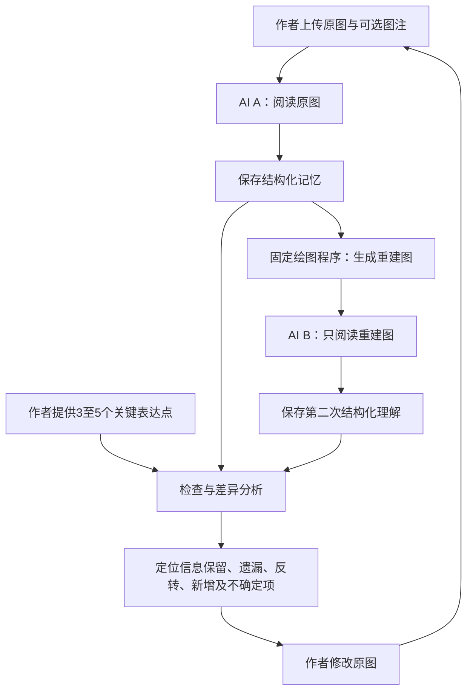

**我们要做的是一个面向复杂科研图的信息传达质量检查工具：让 AI 模拟读者，经历“看图理解 → 留下记忆 → 根据记忆重画 → 另一个 AI 再理解”的过程，检查作者想表达的信息在传递中保留了多少、丢失了什么、哪里发生了误读，并帮助作者修改原图。**

以下方案整合了我们目前讨论的产品目标、核心构想、实现方式、样例准备、验证方法和黑客松范围。它是一份待确认的方案，尚未开始开发。

## 一、为什么做这个工具

科研作者对自己的研究和图示非常熟悉，容易高估读者对图的理解程度。尤其是复杂机制图，作者眼中清楚的箭头、分组、图例和条件说明，读者可能形成另一种理解。

目前我们想解决的核心问题是：

> **作者想通过这张图传达的关键信息，能否被读者准确理解、记住，并重新表达出来？**

例如，作者希望表达：

- A 促进 B。
- B 抑制 C。
- D 对 B 的影响只是推测关系。
- 整个过程仅在条件 X 下发生。

读者理解后却可能变成：

- B 促进 C。
- 推测关系被当成已证实关系。
- 条件 X 被遗漏，结论被误认为普遍成立。

这些不是单纯的美观问题，而是科学信息传达中的损失或失真。

工具的实际用途是：**在论文投稿、组会汇报或成果展示前，提供一次模拟读者反馈，让作者提前发现值得检查和修改的表达问题。**

## 二、目标用户与使用场景

| 用户 | 使用场景 | 希望得到的帮助 |
|---|---|---|
| 论文作者、学生 | 投稿前检查机制图、流程图 | 找出关键信息的遗漏和歧义 |
| 导师、合作者 | 审阅学生或团队绘制的图 | 快速比较作者意图与读者理解 |
| 科研汇报者 | 准备组会、答辩、会议报告 | 检查复杂图是否需要简化或重新组织 |

主要输入是**用户自己制作、尚可修改的科研图**。

从已发表论文提取图片可以作为后续扩展，但第一版不加入自动论文提图，以免同时承担 PDF 解析、子图拆分、上下文整理和标准答案标注的工作。

## 三、我们所说的“复杂、非常规图表”

这里主要指需要结合多种视觉关系理解的科研图，例如：

- 多节点、多路径的机制图。
- 包含促进、抑制、反馈回路的关系图。
- 带分组、空间区域和条件限制的流程图。
- 同时使用颜色、形状、虚实线表达不同含义的图。
- 多面板之间存在引用或跨面板关系的组合图。
- 实验流程、机制解释与结果信息混合的图。

复杂度不只取决于节点数量，也取决于需要同时理解多少种编码、条件和关系。

**第一版只支持带箭头、图例、分组和条件说明的机制图、流程图。** 任意科研图、定量曲线、显微图像和分子结构图暂时不纳入统一评价。

## 四、核心构想：通过重建观察理解

用户提出的核心过程必须保留：

1. 第一个 AI 看原图。
2. 第一个 AI 整理自己需要记忆的信息。
3. 此后不再接触原图，只使用这些记忆。
4. 根据记忆重画它理解中的图。
5. 第二个 AI 只看重建图，提取自己理解到的信息。
6. 检查这些信息与作者原本表达之间的差异。

这里的“记忆”是一个**显式保存的信息表示**，而不是依赖模型隐含记忆。

这个过程属于理解、压缩、重建和再次理解的往返测试。它在直觉上类似生成与评判，但第一版没有生成器和判别器的对抗训练，因此不将其称为 GAN。

**重建图是产品的重要组成部分。** 它不仅用于计算，还让作者直接看到：

> “这是模拟读者读完之后，脑海里形成的图。”

## 五、完整工作流程



作者的关键表达点仅用于检查，**不能提前交给读图的 A、B**。否则模型可能照着答案补全图中没有表达清楚的内容。

### 1．用户输入

必需输入：

- 一张科研图。
- 3–5 个必须让读者理解的关键点。

可选输入：

- 图注。
- 目标受众，例如同领域研究者或跨领域读者。
- 修改前的历史版本。

第一版采用统一的读者设定；不同受众的模拟属于后续扩展。

关键点应尽量原子化，每条只描述一项明确事实：

> K1：A 促进 B。  
> K2：B 抑制 C。  
> K3：上述过程仅在条件 X 下发生。  
> K4：D→B 是尚未验证的推测关系。

### 2．AI A 阅读并形成记忆

AI A 根据原图和允许提供的图注，提取：

| 信息类型 | 内容 |
|---|---|
| 对象 | 节点、名称、角色 |
| 关系 | 起点、终点、方向、促进或抑制等类型 |
| 组织结构 | 分组、区域、面板与层级 |
| 条件 | 哪项关系或过程受什么条件限制 |
| 图例 | 颜色、形状、线型的含义 |
| 证据状态 | 已证实、推测或图中明确标注的其他状态 |
| 不确定项 | 读不清、对应关系不明确、无法确定的内容 |

输出同时包括机器可处理的 JSON 和用户可读的笔记。

每项信息尽量记录原图中的大致位置，供报告定位。位置和内部标识不绘入重建图，也不提供给 B。

A 不应根据领域常识自动“修正”原图。无法确定的内容必须明确保留为不确定。

### 3．根据记忆重建图

为忠实实现“不再看原图”，重建步骤采用新的处理过程，输入仅包含保存的记忆。

**第一版使用固定 SVG 绘图程序，而非自由图片生成。**

理由是控制额外误差：如果 A 正确识别了抑制关系，但绘图模型画成普通箭头，会干扰对原图的判断。

绘图程序支持：

- 节点与标签。
- 有方向的连接。
- 促进、抑制、关联等有限关系。
- 实线、虚线。
- 分组和区域。
- 条件与证据状态标签。

重建图可以使用统一布局和风格，不追求复刻原图的位置、颜色或装饰。**它应保留理解到的科学含义。**

### 4．AI B 独立理解重建图

B 只能接触重建后的图片，以及图片自身包含的标签和图例。

B 不能看到：

- 原图。
- A 的笔记和 JSON。
- 作者的关键表达点。
- 前一次检查报告。

B 输出与 A 相同的信息结构，便于比较。

A、B 初期可以使用同一个视觉模型的独立调用；这能隔离上下文，但不能保证错误独立。后续再测试不同模型组合。

### 5．检查三段信息传递

| 对比 | 目的 |
|---|---|
| 作者关键点 → A 的理解 | 检查原图的核心意思是否被读出 |
| A 的理解 → B 的理解 | 检查重建和再次阅读是否产生额外损失 |
| 作者关键点 → B 的理解 | 检查完整传递后，核心意思保留了多少 |

这样才能避免把所有失败都归因于原图。

此外，A 与 B 的全部提取内容可以进行辅助比较，但不能据此声称已经获得原图的完整标准答案。

## 六、评价什么，怎样评价

核心是**语义保真度，而不是图片相似度**。

两张图布局不同，可能表达完全相同的信息；两张图视觉接近，也可能因为一个箭头方向错误而表达相反结论。

第一版按关键点给出以下状态：

- 正确保留。
- 部分保留。
- 遗漏。
- 关系方向或类型错误。
- 条件、范围或证据状态错误。
- 无法判断。

同时检查是否出现原记忆未包含的新增断言。

示例报告：

| 作者关键点 | A 的理解 | B 的理解 | 观察到的差异 |
|---|---|---|---|
| A 促进 B | 正确 | 正确 | 保留 |
| B 抑制 C | 识别为促进 | 促进 | 第一次阅读发生关系类型错误 |
| 虚线表示推测 | 遗漏 | 遗漏 | 证据状态未恢复 |
| 仅在条件 X 下 | 正确 | 遗漏 | 重建后条件未恢复 |

可汇总的指标包括：

- 关键点完整恢复比例。
- 关系方向与类型的正确恢复比例。
- 条件及证据状态的恢复比例。
- 新增断言数量。
- 重复运行的一致性。

**第一版不提供缺少依据的“综合质量 87 分”。** 逐项问题及其证据比单一分数更有用。

明确的结构和关系优先使用程序比较；同义表达等问题再由语义判断辅助处理。保留判断依据，并允许用户纠正。

## 七、报告与修改建议

页面需要同时展示：

1. 原图。
2. A 的理解笔记。
3. 重建图。
4. 逐项差异报告。
5. 修改前后对比。

点击差异，可以定位原图相关区域，并显示对应笔记。

修改建议必须与观察到的差异连接，例如：

> “抑制关系在第一次阅读中被识别为促进。建议检查该连接的端点符号是否清楚，并考虑添加文字标注。”

但不能直接断言：

> “箭头太小就是误读原因。”

除非通过进一步对照验证了原因。工具首先报告观察结果，原因解释应标明为建议或假设。

作者修改原图后，使用相同关键点和检查设置重新运行，比较信息恢复情况。

自动修改绘图代码、生成最终投稿图属于后续扩展，第一版保留人工修改。

## 八、样例与标准答案准备

开发前先建立样例格式和标注规则，再制作图。

第一批准备 **6 张基础图，每张有清晰版和问题版，共 12 张**：

| 难度 | 数量 | 主要内容 |
|---|---:|---|
| 简单 | 2 张基础图 | 5–8 个节点、基本促进与抑制关系 |
| 中等 | 2 张基础图 | 分组、条件、多条路径、虚实线 |
| 复杂 | 2 张基础图 | 多面板、反馈回路、跨面板关系 |

优先使用可控的自绘示例。第一轮可以采用抽象节点，减少模型凭借已有生物或化学知识猜答案的影响；随后加入领域化样例和少量有明确来源、使用权限的真实科研图。

每张基础图保存：

- 完整语义标准答案。
- 3–5 个关键点。
- 图注及图例。
- 清晰版与问题版。
- 两个版本之间的具体改动。
- 预期影响，但不将其当成已验证结果。
- 来源、许可或自绘说明。
- 开发集或保留测试集标识。

问题版尽量一次只改变一个因素，例如箭头辨识度、标签位置或图例对应方式，同时保持科学含义不变。

如果直接把抑制改成促进，科学含义已经变化，应作为单独的“图与作者意图不一致”案例，不能混入表达清晰度对照。

同一基础图的两个版本必须放在同一数据划分中。保留部分基础图到最后才测试，避免提示词只适应开发样例。

## 九、如何验证工具是否有用

需要区分三个验证问题。

### 1．流程是否忠实

- A、B 是否只接触允许的信息。
- JSON 中的对象和关系是否有效。
- 重建程序是否正确绘制记忆中的关系。
- 不确定信息是否被擅自补全。
- 报告能否追溯到提取结果。

### 2．能否发现已知信息传达问题

对清晰版和问题版使用相同关键点和设置，检查：

- 能否发现预先设置的遗漏或误读。
- 是否对清晰图制造大量误报。
- 同一输入重复运行时是否稳定。

第一轮样例规模只用于验证可行性，不足以证明普遍有效。

### 3．重建步骤是否带来额外价值

必须加入一个简单基线：

> 原图 → 单个 AI 直接检查作者关键点。

再与完整的“理解—重建—再理解”流程比较。

如果重建没有改善诊断，但能帮助作者直观看到误解，它仍有交互价值；如果既不改善诊断，也不帮助修改，就应重新考虑其成本，不能只因构想有趣而保留。

后续可以用少量真人阅读结果验证 AI 反馈是否与真人误读相关。在此之前，产品只能声称提供**模拟 AI 读者反馈**。

## 十、实现结构

| 部分 | 第一版方案 |
|---|---|
| 前端与服务端 | Next.js、TypeScript |
| 图像理解 | 支持图片与结构化输出的模型 API |
| 数据校验 | Zod |
| 图重建 | SVG 与自动布局组件 |
| B 的输入 | SVG 转换后的栅格图片 |
| 差异检查 | 程序规则为主，语义判断辅助 |
| 数据保存 | 本地文件，暂不引入数据库 |
| 版本记录 | 保存原图版本、提示词、模型、参数和运行结果 |

具体模型、SDK 和依赖版本在实施前核对。

API 密钥仅在服务端使用，不进入代码、提交或日志。默认不公开用户图稿。在线模型会接收上传图片，应在使用前明确说明。

## 十一、目录与工程约定

先写 `AGENTS.md`，再建立目录和代码：

```text
AGENTS.md
docs/
  proposal.md
  annotation-guide.md
  evaluation-plan.md
data/
  examples/
  manifests/
src/
  app/
  lib/
    schemas/
    model/
    reconstruction/
    evaluation/
runs/
tests/
```

约定：

- `docs/` 保存方案、标注与验证规则。
- `data/examples/` 保存样例和标准答案。
- `data/manifests/` 保存来源、版本、划分和许可信息。
- `runs/` 保存运行记录，与源数据分开。
- 不覆盖原图，修改版本单独保存。
- 临时文件清理、密钥配置和其他红线操作遵守你的确认要求。

## 十二、单人黑客松实施顺序

| 阶段 | 工作 | 交付 |
|---|---|---|
| 先建规则 | 确定范围、数据格式和验证方式 | `AGENTS.md` 与方案文档 |
| 最小样例 | 制作一张中等复杂度图及其问题版 | 图、关键点、完整语义 |
| 核心验证 | 跑通 A→记忆→重建→B→比较 | 首份可检查报告 |
| 继续或调整 | 与直接读图基线比较，观察重复运行 | 是否值得扩展的判断 |
| 扩充样例 | 补齐开发图与保留测试图 | 小型验证集 |
| 产品页面 | 上传、输入关键点、并排查看、定位差异 | 可交互原型 |
| 演示与验证 | 修改前后对比、保留测试与限制说明 | 演示材料和结果报告 |

优先把一次完整检查做可靠，再增加图类型、模型数量或界面装饰。

## 十三、范围与结论边界

这个工具评价的是**科学信息的可恢复程度**，不是完整的科研图质量，更不是科学结论正确性。

它不能自动证明：

- 原图中的机制是真的。
- 真人一定会发生同样误读。
- AI 读错一定意味着图画得差。
- 修改后得分提高就代表论文质量提高。
- 图中没有被检查的内容没有问题。

尚待验证的关键假设是：

> **AI 的理解与重建差异，能否为作者提供稳定、具体、可用于修改图示的反馈？**

如果能够做到，作品的核心演示就是：**作者上传复杂机制图，看到模拟读者形成的重建图，发现一项关键信息被误解，修改后重新检查，并观察到该信息得到更稳定的恢复。**