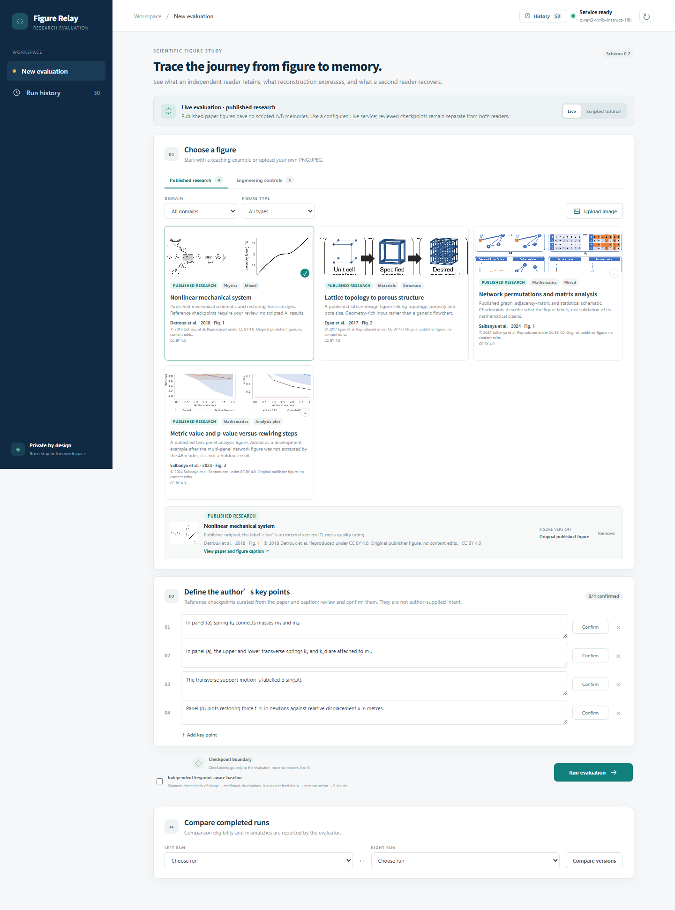
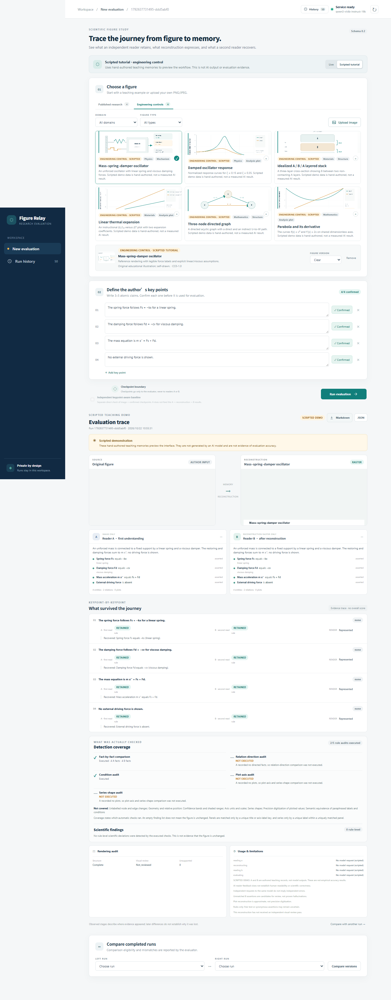

# Figure Relay 使用手册

**版本：0.2 / T10 · 2026-10-22**

Figure Relay 用来检查一件事：作者关心的科学信息，经过一次“读图 → 记忆 → 重建 → 再读”的往返后，还剩下多少。它不是论文结论验证器，也不是真人阅读实验。

本手册按“第一次打开应用”的顺序写。读完第 1–4 节就能完成一次完整评估；第 5 节之后是结果解释、历史对比和故障排查。

---

## 1. 最短路径

如果你只想先跑一次：

1. 启动应用：`npm run dev`，或已经构建过时用 `npm start`。
2. 打开 <http://127.0.0.1:3000>。
3. 在 **Choose a figure** 选择一个 **Engineering control**（脚本教学样例），点击 **Scripted tutorial**。
4. 点击 **Run evaluation**。脚本样例不调用模型，只用来熟悉界面。
5. 看完结果后，再切换到 **Published research**，确认关键点，使用 **Live** 做真实模型评估。

真实评估需要本机 Ollama 视觉模型可用；没有模型时只能运行脚本教学样例。

---

## 2. 启动与环境

### 2.1 软件要求

| 项 | 要求 |
|---|---|
| Node.js | `>=22.12` |
| npm | 随 Node 安装 |
| 浏览器 | 近两年的 Chrome、Edge 或 Firefox |
| 真实运行 | Ollama，以及一个可用的视觉模型 |
| 生产启动 | 先 `npm run build`，再 `npm start` |

依赖已经固定在本项目的 `package-lock.json` 中，首次安装使用：

```powershell
npm ci
```

不要使用全局安装的 Next、TypeScript 或测试工具；本项目使用局部依赖。

### 2.2 启动

开发模式（改代码后自动刷新）：

```powershell
npm run dev
```

生产模式（更接近交付状态，启动前需要构建）：

```powershell
npm run build
npm start
```

默认地址：<http://127.0.0.1:3000>。

### 2.3 真实模型准备

本地默认使用 Ollama，默认地址为 `http://127.0.0.1:11434/v1`，不需要 API key。

先确认 Ollama 正在运行：

```powershell
ollama list
```

首次准备模型（只需做一次）：

```powershell
ollama pull qwen3-vl:4b-instruct
ollama create qwen3-vl:4b-instruct-16k -f scripts/Modelfile.qwen3-vl-4b-instruct-16k
```

`qwen3-vl:4b-instruct-16k` 是在原始 4B instruct 模型上派生出的 16384 上下文版本。Ollama 默认的 4096 上下文放不下“图片 + 完整 JSON schema + 提取结果”。

启动应用后，顶部状态应显示 **Service ready**；也可以直接检查：

```powershell
Invoke-RestMethod http://127.0.0.1:3000/api/status
```

关键字段：

```json
{
  "configured": true,
  "model": "qwen3-vl:4b-instruct-16k",
  "protocol": "chat",
  "base_url_host": "127.0.0.1:11434"
}
```

`configured: false` 表示模型未安装、模型名不匹配，或 Ollama 没有响应。此时不要用 Published research 或上传图做 Live 运行。

### 2.4 可配置项

配置由服务端读取环境变量；修改后需要重启应用。不要把密钥写进代码、提交或报告。

| 变量 | 默认值 | 作用 |
|---|---|---|
| `RFE_BASE_URL` | `http://127.0.0.1:11434/v1` | OpenAI-compatible 服务地址 |
| `RFE_MODEL` | 本地默认 `qwen3-vl:4b-instruct-16k` | 模型名，必须与服务端完全一致 |
| `RFE_PROTOCOL` | `chat` | `chat` 或 `responses` |
| `RFE_MAX_OUTPUT_TOKENS` | `10000` | 单次请求最大输出 token |
| `RFE_TIMEOUT_MS` | `300000` | 单次模型请求超时（毫秒） |
| `OPENAI_API_KEY` | 空 | 非本地服务需要；本地 Ollama 不需要 |
| `OPENAI_BASE_URL` | 空 | `RFE_BASE_URL` 的兼容回退 |
| `OPENAI_MODEL` | 空 | `RFE_MODEL` 的兼容回退 |

PowerShell 示例：

```powershell
$env:RFE_MODEL = "qwen3-vl:4b-instruct-16k"
$env:RFE_MAX_OUTPUT_TOKENS = "10000"
npm start
```

本机 8GB 显存下，16k 上下文、10000 输出上限是经过实测的较稳配置。不要为了“跑得更快”盲目提高输出上限；更大的上下文可能溢出到 CPU，反而更慢。

---

## 3. 界面总览



> 上图是 T10 构建的界面截图；图中选中的是脚本演示样例，不代表真实模型结果。

主界面从上到下分为：

| 区域 | 用途 |
|---|---|
| 左侧栏 | **New evaluation**、**Run history**、当前工作区说明 |
| 顶栏 | 运行历史入口、服务状态、模型名、刷新按钮 |
| 模式横幅 | 当前是 Live 还是 Scripted tutorial，以及为什么可用/不可用 |
| 01 Choose a figure | 选择已发表论文图、工程教学样例，或上传自己的图片 |
| 02 Define the author's key points | 编写并逐条确认 3–5 条关键点 |
| 运行栏 | 是否增加独立基线，以及 **Run evaluation** |
| Evaluation trace | 原图、重建图、A/B 记忆、逐项结果、覆盖范围、审计和限制 |
| Compare completed runs | 选择两个已完成运行做同条件比较 |

### 3.1 三种图像来源

**Published research**

内置四张真实论文图，覆盖物理、材料、数学领域。每张图带有来源、作者、许可和论文链接。它们的检查点是项目从论文和 caption 整理的参考检查点，不是作者本人提交的原始意图；界面上会明确标注这一点。

**Engineering controls**

六组自绘教学样例，明确标记为 **scripted**。它们使用手写记忆，不调用 AI，不是模型能力证据。适合用来：

- 熟悉完整流程；
- 观察 clear / challenged 两个版本的差异；
- 验证导出、历史和比较功能。

**上传图片**

支持 PNG、JPEG。文件不超过 10 MB，图片像素不超过 2500 万。上传后只允许 Live 模式，不能使用脚本演示。

### 3.2 开始前的检查清单

- [ ] 顶部显示 **Service ready**（真实运行）
- [ ] 已选择一张图，或上传成功
- [ ] 有 3–5 条关键点
- [ ] 每条关键点都点击了 **Confirm**
- [ ] 已决定是否勾选独立基线
- [ ] 没有其他正在运行的评估（同一时间只允许一个活动运行）

---

## 4. 完成一次评估

### 4.1 选择图像

在 **Published research** 或 **Engineering controls** 中点击卡片。选择后会出现预览，显示图名、版本、来源和许可。

如果该样例有多个版本，使用 **FIGURE VERSION** 选择版本：

- `Clear`：标签、单位和条件更清晰的版本；
- `Challenged`：同一科学内容，但标注更小、更浅或更难读的版本。

版本 ID 只表示界面中的版本，不是质量评分。

### 4.2 编写作者关键点

关键点是这次评估的“标准答案”。应用只检查这些关键点，不检查图上所有内容。

要求：

- 3–5 条；
- 每条是**一个**可判断的科学命题；
- 建议写成“主体 + 关系/数值/条件 + 对象”，例如：
  - “面板 (a) 中，弹簧 k₂ 连接质量 m₁ 和 m₂。”
  - “面板 (b) 的 y 轴是恢复力，单位为牛顿，x 轴是相对位移，单位为米。”
  - “α = 0.05 是图中的参考水平。”
- 每条长度至少 3 个字符，最多 1200 个字符。

操作：

1. 点击 **Add key point** 新增；
2. 直接编辑文本框；
3. 每条点击 **Confirm**；
4. 修改已确认的文本会自动取消确认，需要重新确认；
5. 点击右侧 `×` 删除。

对 Published research，界面会加载项目整理的参考检查点。请先阅读再确认；不要把它们当成作者原始意图，也不要在未核对的情况下直接当成真值。

### 4.3 是否启用独立基线

**Independent keypoint-aware baseline** 是一个单独的请求：直接把“原图 + 已确认关键点”交给模型，让它逐条判断。

它用来回答一个不同的问题：“如果一开始就把答案给模型，它能直接从原图读出来吗？”

它有三个重要限制：

- 只在 Live 模式且服务已配置时可勾选；
- 结果不回流到 A → 重建 → B 的主链路；
- 它不是另一个盲读者，不能和 Reader B 当作同一条件下的重复测量。

不勾选也能得到完整的主链路结果。只有在你想比较“直接看图 + 答案”和“完整往返”时才需要它。

### 4.4 运行

点击 **Run evaluation**。页面会依次显示四个阶段：

| 阶段 | 界面名 | 输入 | 做什么 |
|---|---|---|---|
| `reading_a` | Read A | 只有原始图 | Reader A 写结构化记忆 |
| `reconstructing` | Reconstruct | 只有 A 的记忆 | 确定性渲染器画 SVG/PNG，不调用模型 |
| `reading_b` | Read B | 只有重建后的 PNG | Reader B 写第二份记忆 |
| `evaluating` | Evaluate | 关键点 + A 记忆 + B 记忆 | 逐条比较并生成报告 |

如果启用了基线，评估结束后还会有一个独立的 direct check 阶段。

运行期间：

- 页面每约 1.4 秒轮询一次状态；
- 刷新或暂时关闭页面不会删除服务端已开始的运行；
- 同一时间只允许一个活动运行，第二次提交会提示 **Another evaluation is running**；
- 如果服务重启，未完成的运行会被标记为 `interrupted`，不会伪装成完成。

真实 4B 模型的耗时取决于硬件、图片复杂度和上下文。慢的时候不要反复点击 **Run evaluation**；先看运行状态和历史记录。

---

## 5. 读懂结果



> 上图是脚本教学运行，不是真实模型输出。真实结果会显示 LIVE 标记和模型调用信息。

### 5.1 原图与重建图

结果页顶部并排显示：

- **Original figure**：作者输入的原图；
- **Reconstruction**：渲染器仅根据 A 的记忆生成的栅格图。

重建是**概念重建**，不是高精度图表数字化。曲线、位置和文字可能近似；不要把重建图当作原图的像素级副本。

### 5.2 Reader A / Reader B 记忆卡

- **Reader A · first understanding**：A 只看了原图；
- **Reader B · after reconstruction**：B 只看了重建图。

展开后可以看到摘要、事实、实体/关系数量和 plot 数量。卡片上的 `IMAGE ONLY` 和 `RECONSTRUCTION RASTER ONLY` 是输入边界的提示，不是宣传语。

### 5.3 逐项判定

每个关键点会显示两列：

| 字段 | 含义 |
|---|---|
| **A · first read** | Reader A 的记忆是否支持这条关键点 |
| **B · second read** | Reader B 的记忆是否支持这条关键点 |
| **RENDER** | A 中匹配到的内容是否被渲染器标为已表达、未支持或未知 |
| ** rationale** | 判定依据；通常引用匹配到的记忆条目 |
| **Suggestion** | 下一步人工检查建议，不是自动修复方案 |

判定状态：

| 状态 | 含义 | 怎么用 |
|---|---|---|
| `retained` | 在当前记忆中找到了支持该命题的证据 | 仍需看方法和引用条目 |
| `partial` | 部分要素存在，部分缺失或不一致 | 看 rationale 和 issue types |
| `omitted` | 没有找到支持证据 | 不等于“原图没有”，只说明当前记忆没提取到 |
| `contradicted` | 找到了明确相反的内容 | 优先级最高，必须人工复核 |
| `uncertain` | 证据不足、歧义或规则无法稳定判断 | 不要当成通过，也不要当成失败 |

判定方法：

- `rule`：确定性文本/结构规则；
- `semantic_assist`：模型辅助语义判断，结果需要复核；
- `manual`：人工判定（当前界面主要展示前两种）。

只要判定带有 `review` 或 **REVIEW** 标记，就应当人工检查引用条目和原图，不要直接采信。

### 5.4 Observed stage：差异出现在哪一段

`Observed stage` 只描述**证据出现在哪一段**，不证明原因。

| 值 | 解释 |
|---|---|
| `none` | A 和 B 都保留；没有观察到这条信息的损失 |
| `round_trip` | A 保留了，B 没有；差异出现在往返之后 |
| `first_read` | A 没有保留；B 可能恢复，也可能同样没有保留，且没有可归因于往返的事实变化 |
| `both` | A 和 B 都没有保留，并且 A → B 的事实链显示两端都发生了变化 |
| `unresolved` | 判定不确定，或没有稳定的 A → B 事实对齐，无法定位阶段 |

看到 `round_trip` 也不要直接说“重建图害的”。它只说明 A 有、B 没有；还要检查渲染审计、覆盖范围和 B 的实际输入。

### 5.5 检测覆盖（Detection coverage）

这一块回答“到底执行了哪些检查”，比“有没有发现差异”更重要。

| 检查 | 说明 |
|---|---|
| Fact-by-fact comparison | 是否逐条比较了 A/B facts，以及两边各有多少条 |
| Relation-direction audit | 是否检查了关系方向反转 |
| Condition audit | 是否检查了条件文本丢失 |
| Plot-axis audit | 是否检查了坐标轴单位、尺度和数值范围 |
| Series-shape audit | 是否检查了唯一匹配系列的形状变化 |

状态含义：

- **Executed**：这项检查实际运行了；
- **NOT EXECUTED**：没有运行，原因会写在旁边；
- **Not covered**：本报告明确没有覆盖的内容。

关键规则：

> **空差异列表 ≠ 没有变化。**

如果某项检查没有执行，或者面板/系列没有唯一匹配，报告不能据此声称“图没有被改坏”。旧运行可能显示 **LEGACY REPORT**，表示它产生于覆盖元数据之前，不能反推检查结果。

### 5.6 Scientific findings

这里是确定性的科学差异审计，可能出现：

- relation direction（关系方向）；
- condition loss（条件丢失）；
- value change（数值变化）；
- threshold / level（阈值或水平变化）；
- axis unit or scale（轴单位或尺度）；
- series shape change（系列形状）。

每条 finding 有：

- `confirmed`：规则找到明确证据；
- `uncertain`：可能有差异，但证据不足或有歧义；
- `REVIEW`：需要人工复核。

这些 finding 是“值得检查的差异”，不是论文错误，也不是模型幻觉的证明。

### 5.7 Rendering audit

| 字段 | 含义 |
|---|---|
| Structure | 渲染结构审计：`complete` / `incomplete` / `failed` |
| Visual review | 人工视觉复核：`not_reviewed` / `passed` / `failed` |
| Unsupported | 渲染器明确标为无法表达的记忆条目数 |
| Warnings | 具体渲染警告 |

`not_reviewed` 是默认状态，**不是通过**。在没有人工看过重建图之前，不要把它改成 `passed`，也不要在报告里说重建“视觉上没问题”。

### 5.8 Usage & limitations

这里显示每个阶段的：

- 延迟；
- token 用量；
- 请求次数；
- 是否 `usage partial`；
- 是否为 legacy audit；
- 配置快照（模型、协议、上下文长度、摘要）。

`usage partial` 表示部分请求没有返回完整的 token 计数，不表示运行失败。未知值不会被补成 0。

`limitations` 是报告的一部分，不是页脚装饰。常见限制包括：

- AI 读者反馈不等于真人可读性；
- 同一模型的两次独立请求不等于统计独立；
- B 中多出来的断言只是复核候选，不是已证明的幻觉；
- 绘图是近似重建，不是精密数字化；
- 语义判定需要复核；
- 重建图尚未经过独立视觉复核。

### 5.9 Additional claims in B

如果 B 的记忆中有 A 没有的事实，会出现在 **Additional claims in B**。它们可能是：

- 合理的补充；
- 语义等价的改写；
- 模型新增的、原图没有的内容。

当前规则只把它们标为 **review recommended**，不会自动判为错误。请对照原图和 B 的引用条目。

### 5.10 独立基线结果

如果启用了基线，会看到：

- **Independent keypoint-aware baseline** 面板；
- 每条关键点的 direct check 判定；
- 模型、延迟、token 和请求次数。

基线与主链路是两套结果。基线失败时，主结果仍然保留，并显示失败原因；不要把基线失败当成主评估失败。

---

## 6. 历史、深链接与比较

### 6.1 运行历史

点击左侧 **Run history** 或顶栏 **History**：

- 默认列出最近 50 条运行；
- 可以按 Run ID、图名、模式或状态过滤；
- 每次点 **Show more** 增加 10 条；
- 旧运行不在最近列表中时，使用 **Open run by ID** 输入完整 ID。

运行 ID 形如 `1792609657136-e85156a8`。完整 ID 也可以直接作为深链接：

```text
http://127.0.0.1:3000/?run=1792609657136-e85156a8
```

历史记录中的失败和中断运行不会被删除或改写成成功。它们仍然可以打开查看错误阶段和原因。

### 6.2 比较已完成运行

在 **Compare completed runs** 中选择左右两个运行，点击 **Compare versions**。

比较结果会先给出：

- **COMPARABLE**：关键点、设置和模式一致；
- **NOT DIRECTLY COMPARABLE**：至少一项不一致，并列出差异原因。

比较表显示每条关键点在左右两次运行中的 **B 侧状态**。这不是“改进百分比”，也不证明某次运行更好；它只是同条件配对观察。

当前版本的可比较性由运行内部的 keypoint digest 和 settings digest 决定。内置示例会加载固定的关键点 ID，因此同一示例的重复运行可以直接比较。

**上传图片的限制：**当前界面会为每次上传新建关键点生成新的 ID，即使文字完全相同，也可能被判定为 **Author keypoints differ**。因此，自定义图片的两次上传目前不保证可直接比较。真实图修改对照需要固定关键点 ID；这属于下一阶段工作，不要用两次独立上传的左右状态冒充严格对照。

### 6.3 导出报告

运行完成后，结果页右上角有：

- **Markdown**：适合人读的表格和限制说明；
- **JSON**：完整的运行快照，适合程序处理或留档。

文件名形如：

```text
figure-relay-<run-id>.md
figure-relay-<run-id>.json
```

导出内容可能包含关键点、A/B 记忆、报告和运行元数据。分享前先检查是否包含未发表图片、内部数据或敏感信息。原图本身不在报告里重复嵌入，但运行记录和资产仍应视为私有数据。

---

## 7. 三种推荐工作流

### 7.1 五分钟熟悉界面（不调用模型）

1. 选择 **Engineering controls**；
2. 选择任意教学样例；
3. 保持 **Scripted tutorial**；
4. 确认 4 条关键点；
5. 点击 **Run evaluation**；
6. 观察结果页的 A/B 记忆、判定、覆盖范围、渲染审计；
7. 导出一次 Markdown 和 JSON。

这条路径只验证界面和脚本数据，不产生真实模型证据。

### 7.2 真实论文图评估

1. 确认 **Service ready**；
2. 选择 **Published research** 中的一张图；
3. 逐条阅读项目整理的参考检查点，必要时修改；
4. 确认全部关键点；
5. 可选：勾选独立基线；
6. 点击 **Run evaluation**，等待完成；
7. 先看 **Detection coverage**，再看逐项判定；
8. 对 `uncertain`、`review`、`contradicted` 和 `round_trip` 条目做人工核对；
9. 导出报告，记录模型、prompt 和运行 ID。

### 7.3 上传自己的图

1. 准备 PNG/JPEG，控制在 10 MB、2500 万像素以内；
2. 点击 **Upload image**；
3. 自己写 3–5 条原子关键点并逐条确认；
4. 使用 Live 运行；
5. 不要把未发表或敏感图上传到不受信任的远程服务；本地 Ollama 可以避免图片离开本机。

上传图的运行只在当前工作区保存。需要分享时导出报告，并自行确认内容。

---

## 8. 运行边界与科学口径

### 8.1 这个工具能回答什么

- 作者指定的关键点在 A 的记忆中是否出现；
- 在 B 的记忆中是否出现；
- 重建图是否表达了 A 中匹配到的条目；
- 哪些确定性规则检查实际执行了，哪些没有；
- 两个同条件运行之间，B 侧状态有什么配对差异。

### 8.2 这个工具不能回答什么

- 不能证明论文结论正确；
- 不能测量真人读者的记忆或理解；
- 不能给出一个“图质量总分”；
- 不能保证任意科研图都能被模型完整读取；
- 不能把 `omitted` 直接解释为原图缺少该信息；
- 不能把 `unmatched B` 直接解释为模型幻觉；
- 不能把同一模型的 A/B 两次调用当成统计独立的重复实验；
- 不能把近似重建的曲线当作精确数字化结果。

### 8.3 输入隔离

| 角色 | 能看到什么 |
|---|---|
| Reader A | 只有原始图 |
| Renderer | 只有 A 的持久化记忆 |
| Reader B | 只有重建后的 PNG，不读 SVG 源码、JSON、原图或关键点 |
| Evaluator | 关键点 + A 记忆 + B 记忆 |
| 独立基线 | 原图 + 已确认关键点，独立请求 |

关键点不会送给 Reader A 或 Reader B。基线结果不会回流主链路。

### 8.4 数据位置与隐私

- 当前应用是本地单工作区，没有登录或权限系统；不要不加保护地暴露到公网；
- 私有上传、真实调用记录、运行产物在 `runs/<run-id>/`；
- `runs/` 不进入 git；
- 可分享的验证证据在 `artifacts/validation/`，但其中也可能包含运行摘要，分享前应检查；
- 密钥只从服务端环境读取，不进入代码、提交、提示词、报告或日志；
- 使用远程 OpenAI-compatible 服务时，原图、重建图和必要记忆会发送到该服务；用本地 Ollama 则留在本机。

---

## 9. 常见问题与故障排查

| 现象 | 可能原因 | 处理 |
|---|---|---|
| 顶部显示 **Service not configured** | Ollama 未运行、模型名不一致、模型未安装 | `ollama list`；确认 `qwen3-vl:4b-instruct-16k` 存在；检查 `/api/status` |
| **Live mode is unavailable** | 服务未配置，或当前选了 Published/上传图但模型不可用 | 先修好模型服务；脚本模式只适用于 Engineering controls |
| **Another evaluation is running** | 同一时间只允许一个活动运行 | 等待完成或在历史中查看；不要重复提交 |
| **Upload exceeds the 10 MB image limit** | 文件过大 | 压缩或缩小图片，保持 PNG/JPEG |
| **Choose a PNG or JPEG image** | 上传了 SVG、WebP、PDF 等 | 先转换为 PNG/JPEG；上传不接受 SVG |
| **Add 3–5 complete atomic keypoints** | 数量不足或某条文本太短 | 补足 3–5 条，每条至少 3 个字符 |
| **Confirm each author keypoint** | 有未确认条目 | 逐条点击 Confirm；修改文本后要重新确认 |
| 运行失败并显示 `no_readable_content` | Reader 认为图片不可读或内容不足 | 换更高分辨率/更清晰的图；查看失败阶段；保留失败记录 |
| 请求超时 | 本地模型慢、上下文太大或显存不足 | 使用 16k/10000 配置；关闭其他占显存程序；不要无限重试 |
| `usage partial` | 部分响应没有返回完整 usage | 正常记录为不完整；不要当成 0 |
| `Rendering audit: incomplete` | 部分记忆无法被绘制 | 查看 Unsupported 和 Warnings；不要把重建图当完整表达 |
| `visual_review: not_reviewed` | 还没有人工视觉复核 | 人工检查重建图；不要自行改成 `passed` |
| 覆盖面板显示 **LEGACY REPORT** | 旧运行没有覆盖元数据 | 不能反推未执行检查的结果；以新运行或原始记录为准 |
| 历史中找不到旧运行 | 最近列表只显示 50 条 | 用 **Open run by ID** 输入完整 ID，或使用深链接 |
| 比较显示 **Author keypoints differ** | 两次运行的关键点或 ID 不同；上传图会重新生成 ID | 内置示例的固定关键点可以比较；自定义上传的严格对照需要固定关键点 ID |
| 导出的 JSON 很大 | 包含完整运行快照和记忆 | 用 Markdown 做阅读摘要；JSON 留档或程序处理 |

### 9.1 运行失败后怎么办

失败运行会保留在历史中，状态为 `failed` 或 `interrupted`。先看错误信息里的阶段：

- `reading_a`：原图读取失败；
- `reconstructing`：记忆投影或绘图失败；
- `reading_b`：重建图读取失败；
- `evaluating`：比较或语义判定失败；
- `baseline`：独立基线失败（主结果可能仍然完整）。

不要通过删除失败记录、改状态或重跑覆盖来“修复”结果。修正输入或环境后，新建一个运行，保留两者。

---

## 10. 开发者附注

这一节面向需要维护或复验项目的人，不是普通使用流程。

### 10.1 验证命令

```powershell
npm run validate
```

依次执行：

- `tsc --noEmit`；
- ESLint；
- Vitest；
- Next 生产构建。

浏览器和证据脚本需要本地服务运行：

```powershell
node scripts/browser-smoke.mjs --label T11-browser-smoke
node scripts/history-browser.mjs --label T11-history-browser
node scripts/smoke-api.mjs --label T11-api-smoke
```

详细验证状态和证据索引见 [DELIVERY_VALIDATION.md](DELIVERY_VALIDATION.md)。

### 10.2 证据不可覆盖

证据生成脚本使用独立 `--label`，默认拒绝写入已存在的同名文件。重跑时：

1. 先选一个新的 label；
2. 不要删除旧证据来绕过保护；
3. 不要修改旧运行或旧统计来让结果“一致”。

如果脚本提示 **Refusing to overwrite existing evidence**，这是保护生效，不是脚本坏了。

### 10.3 当前版本

- Schema：`0.2.0`
- Prompt：`reader-0.2.2`
- 默认模型：`qwen3-vl:4b-instruct-16k`
- 默认上下文：16384
- 默认输出上限：10000

---

## 11. 一页速查

```text
启动：npm ci → npm run dev
生产：npm run build → npm start
地址：http://127.0.0.1:3000

真实模型：
  ollama list
  ollama pull qwen3-vl:4b-instruct
  ollama create qwen3-vl:4b-instruct-16k -f scripts/Modelfile.qwen3-vl-4b-instruct-16k

一次评估：
  选图 → 3–5 条关键点 → 每条 Confirm → Run evaluation

最重要的三句话：
  1. 空差异列表不等于没有变化。
  2. visual_review=not_reviewed 不等于通过。
  3. 阶段差异只说明证据在哪一段，不证明原因。
```

---

相关文档：

- [README](../README.md)
- [实现合同](IMPLEMENTATION.md)
- [验证与证据](DELIVERY_VALIDATION.md)
- [真实论文图来源](REAL_FIGURES.md)
- [提交检查表](submission/CHECKLIST.md)
